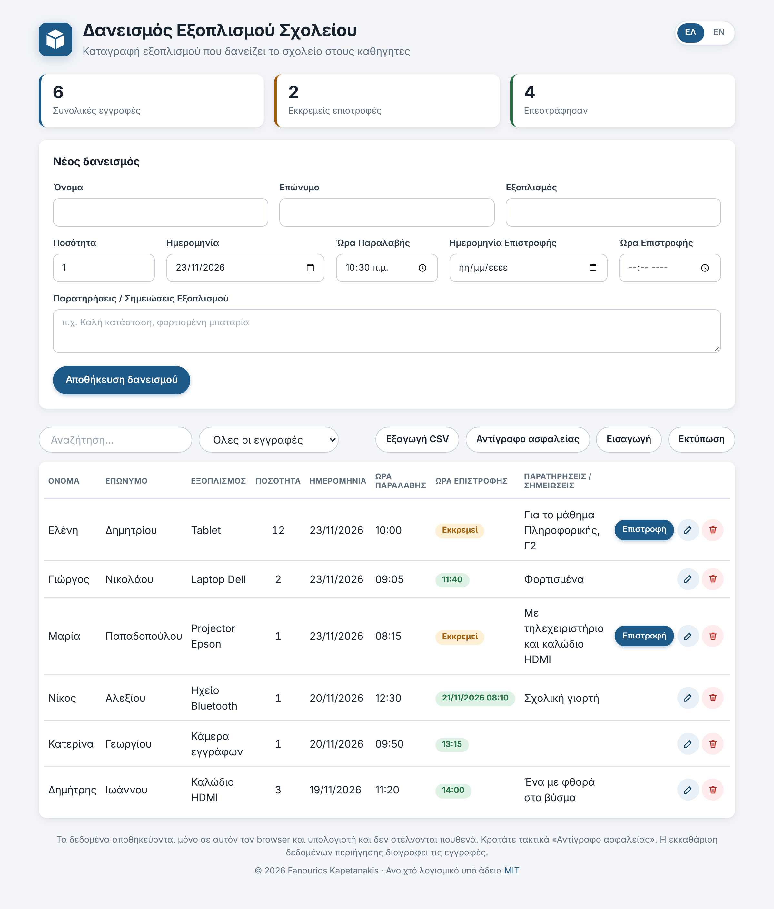
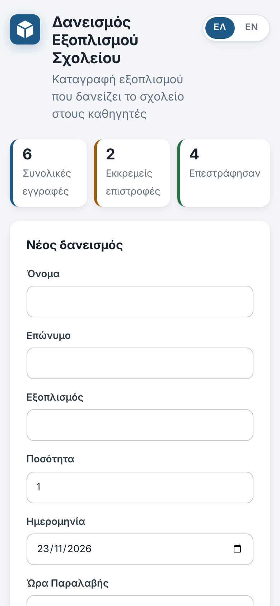

🇬🇷 **Ελληνικά** · [🇬🇧 English](README.en.md)

# 📦 Δανεισμός Εξοπλισμού Σχολείου

**Απλή εφαρμογή για την καταγραφή του εξοπλισμού που δανείζει το σχολείο στους καθηγητές.**
Χωρίς εγκατάσταση, χωρίς λογαριασμούς, χωρίς server. Ανοίγει σε οποιονδήποτε browser.

[**▶ Άνοιγμα εφαρμογής**](https://kapetanakisfanis.github.io/school-equipment-loans/)

---

## 📸 Στιγμιότυπα

  

   
  Λειτουργεί και σε κινητό. Τα ονόματα στις εικόνες είναι φανταστικά.

## ✨ Τι κάνει

| | |
|---|---|
| **Καταχώριση δανεισμού** | Όνομα, επώνυμο, εξοπλισμός, ποσότητα, ημερομηνία, ώρα παραλαβής, ημερομηνία και ώρα επιστροφής (και για δανεισμούς πολλών ημερών) |
| **Εκκρεμείς επιστροφές** | Οι εγγραφές χωρίς ώρα επιστροφής εμφανίζονται ως «Εκκρεμεί», με κουμπί «Επιστροφή» που συμπληρώνει την τρέχουσα ημερομηνία και ώρα |
| **Αναζήτηση και φίλτρα** | Εύρεση ανά καθηγητή, εξοπλισμό ή σημείωση, και προβολή μόνο εκκρεμών ή επιστραμμένων |
| **Επεξεργασία και διαγραφή** | Διόρθωση ή αφαίρεση οποιασδήποτε εγγραφής |
| **Εξαγωγή σε Excel** | Αρχείο CSV (UTF-8) που ανοίγει απευθείας στο Excel |
| **Εκτύπωση** | Καθαρή εκτυπώσιμη λίστα |
| **Αντίγραφο ασφαλείας** | Αποθήκευση και επαναφορά όλων των εγγραφών από αρχείο |
| **Δύο γλώσσες** | Ελληνικά και Αγγλικά, με κουμπί ΕΛ / EN. Η επιλογή αποθηκεύεται |

## 🚀 Πώς το χρησιμοποιώ

### Επιλογή 1: Online (GitHub Pages)
Ανοίγεις τον σύνδεσμο της εφαρμογής από οποιονδήποτε υπολογιστή ή κινητό. Δεν χρειάζεται τίποτα άλλο.

### Επιλογή 2: Τοπικά, χωρίς internet
1. Πάτα **Code → Download ZIP** σε αυτή τη σελίδα.
2. Κάνε αποσυμπίεση του αρχείου.
3. Άνοιξε το `index.html` με διπλό κλικ (Chrome, Edge ή Firefox).

## 🔒 Προσωπικά δεδομένα (GDPR)

- Τα δεδομένα **αποθηκεύονται μόνο στον browser** του υπολογιστή που χρησιμοποιείτε. Δεν στέλνονται σε κανέναν server και δεν ανεβαίνουν στο GitHub. Αν ανοίγετε την εφαρμογή online, το GitHub φιλοξενεί τη σελίδα και βλέπει τεχνικά στοιχεία των επισκεπτών (π.χ. διεύθυνση IP), ενώ οι εγγραφές δανεισμού μένουν πάντα τοπικά. Για χρήση χωρίς καμία επικοινωνία με το GitHub, χρησιμοποιήστε την τοπική επιλογή (Download ZIP).
- Δεν χρησιμοποιούνται εξωτερικές υπηρεσίες, cookies παρακολούθησης ή αναλυτικά στοιχεία.
- Καταγράφεται μόνο το ονοματεπώνυμο του καθηγητή, δηλαδή το ελάχιστο απαραίτητο.
- Για διαγραφή δεδομένων καθηγητή αρκεί η διαγραφή των αντίστοιχων εγγραφών.

> ⚠️ **Σημαντικό:** Μην ανεβάζετε ποτέ στο repository αρχεία αντιγράφου ασφαλείας (`.json`) ή εξαγωγές (`.csv`) με πραγματικά ονόματα. Το `.gitignore` τα αποκλείει αυτόματα.

## 💾 Πρέπει να ξέρεις

- **Κάθε υπολογιστής και browser έχει τη δική του λίστα.** Οι εγγραφές δεν μοιράζονται αυτόματα μεταξύ υπολογιστών.
- Για να μεταφέρεις δεδομένα σε άλλον υπολογιστή: **Αντίγραφο ασφαλείας** στον πρώτο, μετά **Εισαγωγή** στον δεύτερο.
- Αν καθαρίσεις τα δεδομένα περιήγησης του browser, οι εγγραφές διαγράφονται. Κράτα τακτικά αντίγραφο ασφαλείας και αποθήκευσέ το σε ασφαλές, κρυπτογραφημένο μέρος.

## 🛠️ Για όσους θέλουν να το προσαρμόσουν

Όλη η εφαρμογή είναι ένα αρχείο, το `index.html` (HTML, CSS και JavaScript, χωρίς βιβλιοθήκες). Μπορείς να αλλάξεις πεδία, χρώματα ή κείμενα με οποιονδήποτε επεξεργαστή κειμένου. Όλα τα κείμενα και των δύο γλωσσών βρίσκονται μαζεμένα στο αντικείμενο `T`, στην αρχή του κώδικα JavaScript. Για αλλαγές, ανοίξτε ένα *Issue* ή ένα *Pull Request*.

## 📜 Άδεια χρήσης

Διατίθεται ως ανοιχτό λογισμικό υπό την [άδεια MIT](LICENSE). Μπορείτε ελεύθερα να το χρησιμοποιήσετε, να το τροποποιήσετε και να το μοιραστείτε, διατηρώντας τη σημείωση πνευματικών δικαιωμάτων.

© 2026 Fanourios Kapetanakis

## 📄 Σημείωση συμμόρφωσης

Η εφαρμογή παρέχεται ως εργαλείο οργάνωσης. Πριν τη χρήση σε σχολική μονάδα, συμβουλευτείτε τον Υπεύθυνο Προστασίας Δεδομένων (ΥΠΔ) και καταχωρίστε την επεξεργασία στο Αρχείο Δραστηριοτήτων του σχολείου.
